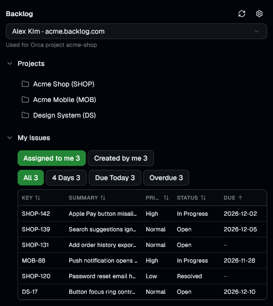
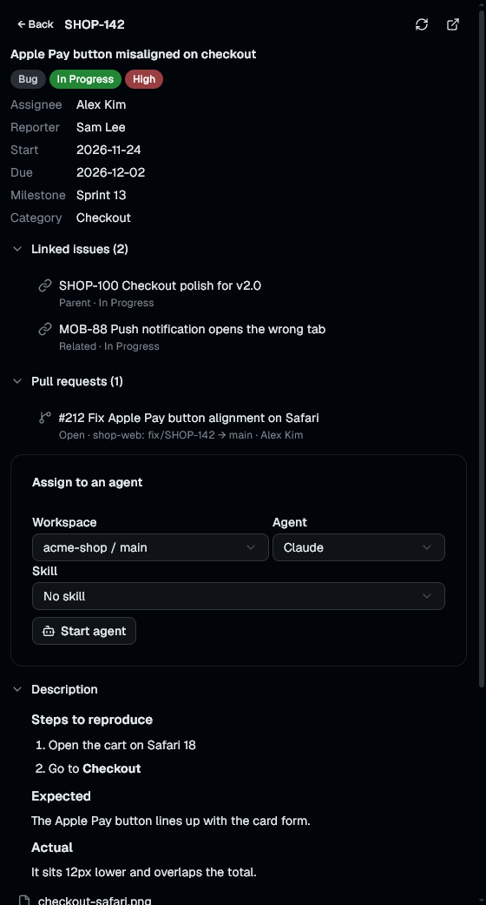
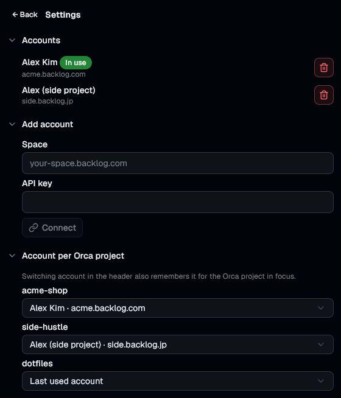

<div align="center">

# Backlog for Orca

**Your Nulab Backlog issues in Orca's sidebar.**<br>
Find the ticket, read it, and hand it to an agent without leaving your workspace.

[](https://github.com/ngxuancam/orca-backlog/tags)
[](https://github.com/ngxuancam/orca-backlog)
[](LICENSE)




</div>

---

## Why

Working a Backlog ticket usually means a browser tab for the issue, another for the pull request,
a download folder full of screenshots, and copy-pasting the description into your agent.
Backlog for Orca puts all of it in Orca's right sidebar, drawn with Orca's own controls, and
starts an agent on the ticket in one click.

## Features

### 🏠 A dashboard like Backlog's


- **Projects** you belong to; click one to open its issues with the project filter already set.
- **My Issues**: *Assigned to me* / *Created by me*, then *All*, *4 Days*, *Due Today*, *Overdue*,
  each with its count, the way Backlog's own dashboard shows them.

### 🔎 Search and filters


- Keyword search, **project**, **assignee** (you by default, anyone, or a teammate), **status**
  (Not closed, All, or one) and **priority**.
- **Advanced filters**: issue type, category, version, milestone, registered by, resolution,
  subtasking, attached and shared — the same fields as Backlog's Advanced Search.
- Sortable columns, paging as you scroll; filters fit one row on a wide panel and wrap when narrow.
  Your filters are remembered.

### 📄 Everything about an issue




- Fields, description and comments rendered as Backlog shows them, **images inline**.
- **Linked issues**: parent, subtasks and related issues; open one and *Back* returns here.
- **Pull requests** that link the issue, in any of the project's Git repositories, open ones included.
- **Attachments**: images and videos open in Orca's preview; anything else is saved to
  `~/Downloads/orca-backlog-<project>/` and its folder opens.

### 🤖 Hand it to an agent

- Pick a workspace (or a new worktree), an agent and a **skill**; the issue becomes the agent's task.
- Your last agent, skill and workspace are remembered for the next ticket.

### 👥 Several accounts




- Add as many Backlog accounts as you need; switch from the header.
- Each **Orca project remembers its account**: switch once while you're in it, or set it in ⚙ Settings.
  Moving to another workspace switches to its account by itself.

## Install

```sh
orca plugin install ngxuancam/orca-backlog
```

Orca shows the access the plugin asks for (its own storage and encrypted secrets, reading and
opening your workspaces, creating worktrees, starting agents) and asks you to approve it.

Then open **Backlog Tasks** in the right sidebar and sign in with your space
(`your-space.backlog.com`) and a personal API key from *Backlog → Personal settings → API*.

## Tips

- **Already use [backlog-mcp-server](https://github.com/nulab/backlog-mcp-server)?** With no account
  saved, the plugin picks up `BACKLOG_DOMAIN` / `BACKLOG_API_KEY` from the environment or from an MCP
  config (`~/.claude.json`, Cursor, Windsurf, Claude Desktop, VS Code), so there's nothing to type.
- **Images over 1 MB** don't draw inline; open them from *Attachments* for the full preview.
- Previews saved in a workspace go to `.orca-backlog/`, a folder git ignores on its own.

## Privacy

The plugin talks to your Backlog space directly from your computer, with the same API calls
nulab/backlog-mcp-server makes. API keys stay in Orca's encrypted plugin secrets; nothing is sent
anywhere else.

## Develop

```sh
npm i                      # typings only
npx tsc -p .
orca plugin test . --json
orca plugin check . --json
orca plugin dev watch . --check --json
```

| File              | Role                                                         |
| ----------------- | ------------------------------------------------------------ |
| `src/protocol.ts` | Panel ↔ worker contract                                      |
| `src/panel.tsx`   | The sidebar panel (Orca components, no build step)           |
| `src/worker.ts`   | Request handlers                                             |
| `src/backlog.ts`  | Backlog API client and credential discovery                  |
| `src/accounts.ts` | Saved accounts and the account of each Orca project          |
| `src/inline.ts`   | Backlog text to Markdown, inline images                      |
| `src/files.ts`    | Saving attachments, revealing and opening files              |
| `src/orcaCli.ts`  | Installed agents and skills, as Orca lists them              |

## License

[MIT](LICENSE) © ngxuancam

Backlog is a product of Nulab Inc. This plugin is an independent project, not made or endorsed by Nulab.

---

<div align="center">

Made by **Nguyen Xuan Cam** · [nguyenxuancam.com](https://nguyenxuancam.com)

</div>
