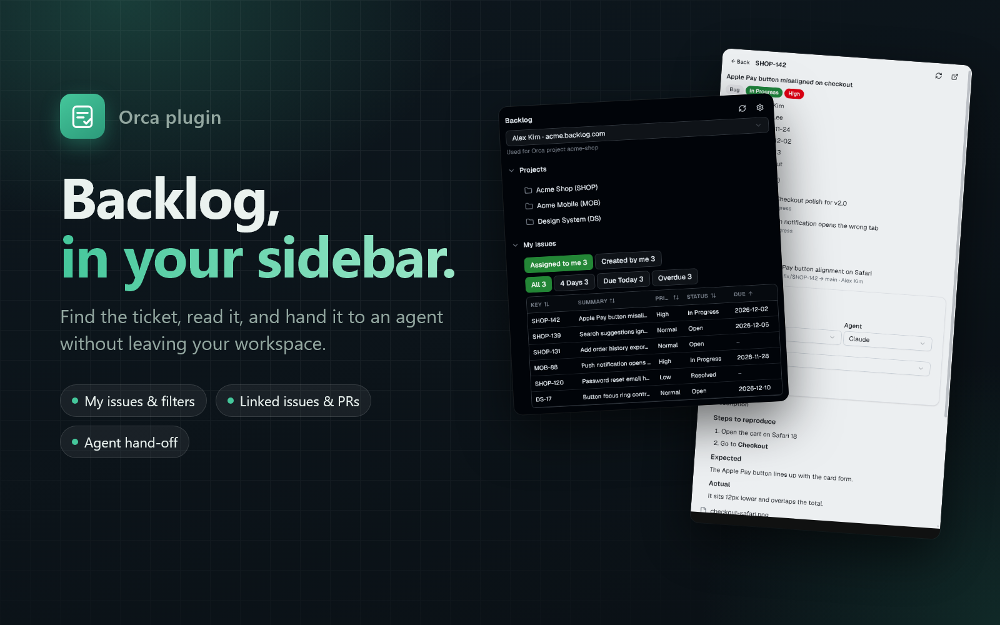
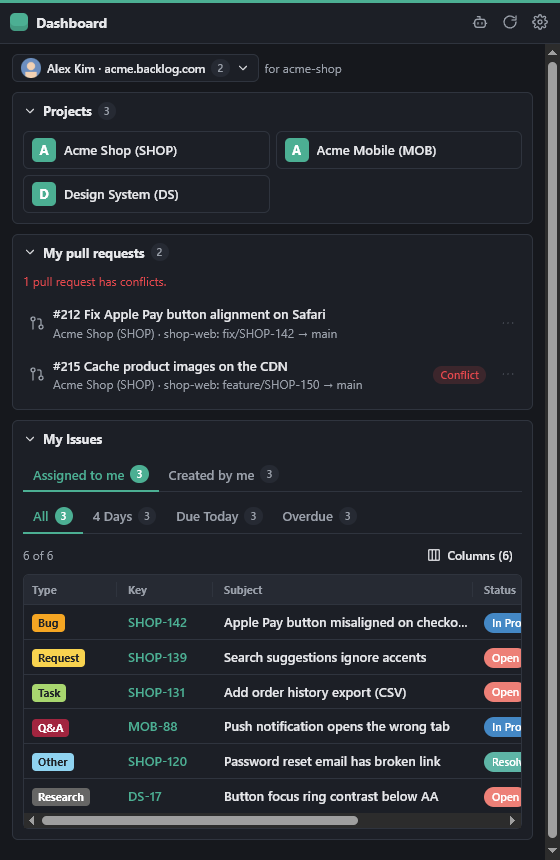
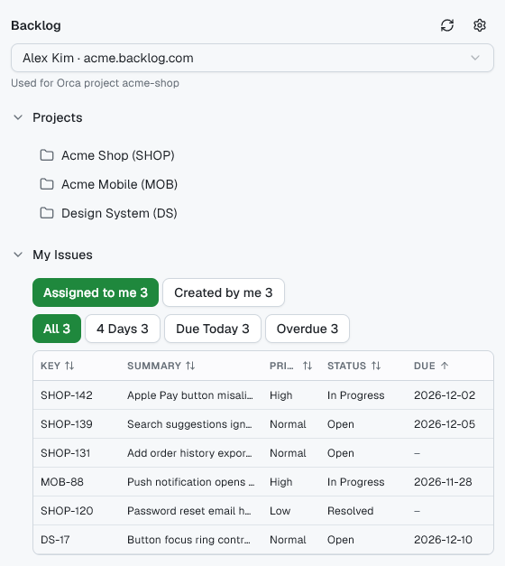
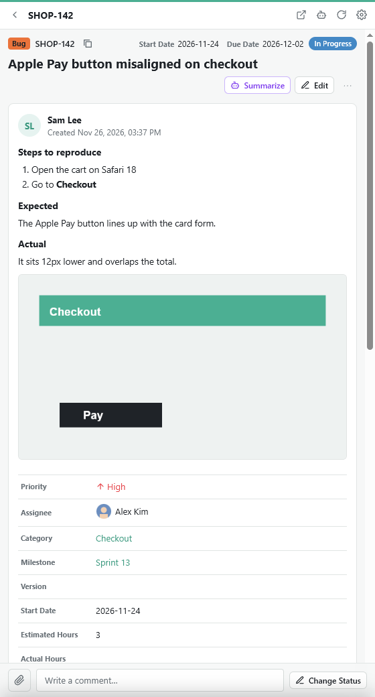
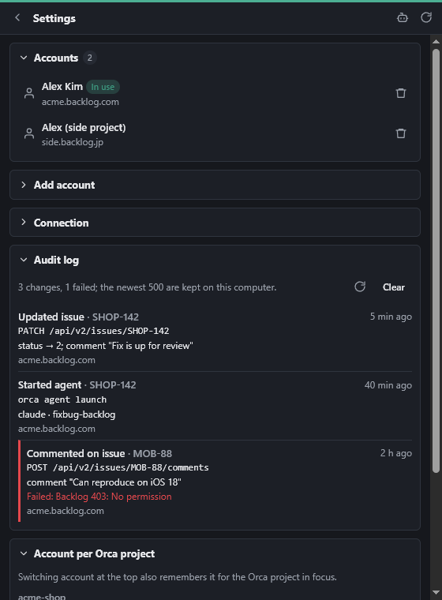
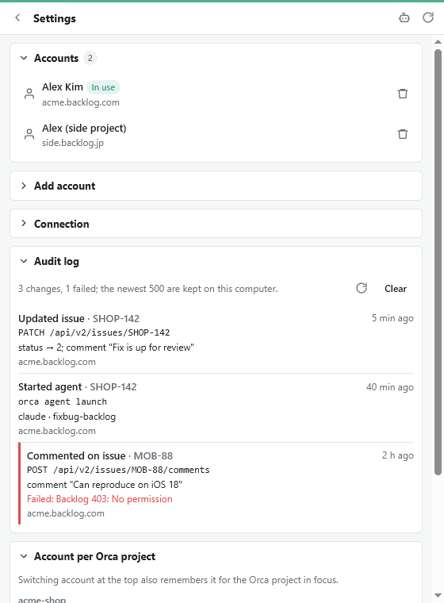

<div align="center">

# Backlog for Orca

**Your Nulab Backlog issues in Orca's sidebar.**<br>
Find the ticket, read it, and hand it to an agent without leaving your workspace.

[](https://github.com/ngxuancam/orca-backlog/releases/latest)
[](https://orca.dev/plugins/ngxuancam/orca-backlog)
[](LICENSE)



</div>

---

## Why

Working a Backlog ticket usually means a browser tab for the issue, another for the pull request,
a download folder full of screenshots, and copy-pasting the description into your agent.
Backlog for Orca puts all of it in Orca's right sidebar, drawn with Orca's own controls in its
light and dark themes, and starts an agent on the ticket in one click.

## Features

### 🏠 A dashboard like Backlog's

<table>
  <tr><th>Dark</th><th>Light</th></tr>
  <tr>
    <td></td>
    <td></td>
  </tr>
</table>

- **Projects** you belong to; click one to open its issues with the project filter already set.
- **My Issues**: *Assigned to me* / *Created by me*, then *All*, *4 Days*, *Due Today*, *Overdue*,
  each with its count, the way Backlog's own dashboard shows them.

### 🔎 Search and filters

- Keyword search, **project**, **assignee** (you by default, anyone, or a teammate), **status**
  (Not closed, All, or one) and **priority**.
- **Advanced filters**: issue type, category, version, milestone, registered by, resolution,
  subtasking, attached and shared — the same fields as Backlog's Advanced Search.
- Sortable columns and paging as you scroll. Filters share one row on a wide panel and wrap when
  it's narrow, and they're remembered.
- Teammates who share a display name show their login, so you pick the right one.

### 📄 Everything about an issue

<table>
  <tr><th>Dark</th><th>Light</th></tr>
  <tr>
    <td></td>
    <td></td>
  </tr>
</table>

- Fields, description and comments rendered as Backlog shows them, line breaks included; each
  image in them is an **Open preview** button that shows it in Orca's image preview.
- The issue type badge takes the type's colour from Backlog (the nearest of Orca's tones).
- **Linked issues**: parent, subtasks and related issues; open one and *Back* returns here.
- **Pull requests** that link the issue, in any of the project's Git repositories, open ones included.
- **Attachments**: images and videos open in Orca's preview; anything else is saved to
  `~/Downloads/orca-backlog-<project>/` and its folder opens.

### 🤖 Hand it to an agent

- Pick a workspace (or a new worktree), an agent and a **skill**; the issue becomes the agent's task.
- Your last agent, skill and workspace are remembered for the next ticket.

### 👥 Several accounts

<table>
  <tr><th>Dark</th><th>Light</th></tr>
  <tr>
    <td></td>
    <td></td>
  </tr>
</table>

- Add as many Backlog accounts as you need; switch from the header.
- Each **Orca project remembers its account**: switch once while you're in it, or set it in ⚙ Settings.
  Moving to another workspace switches to its account by itself.

## Install

Requires **Orca 1.4.259** or later, on macOS, Windows or Linux.

```sh
orca plugin install ngxuancam/orca-backlog
```

Or in Orca: **Settings → Plugins → Add plugin → From a Git URL…** and paste
`https://github.com/ngxuancam/orca-backlog`.

Orca shows the access the plugin asks for (its own storage and encrypted secrets, reading and
opening your workspaces, creating worktrees, starting agents) and asks you to approve it.

Then open **Backlog Tasks** in the right sidebar and sign in with your space
(`your-space.backlog.com`) and a personal API key from *Backlog → Personal settings → API*.

## Tips

- **Already use [backlog-mcp-server](https://github.com/nulab/backlog-mcp-server)?** The Connect
  screen lists every `BACKLOG_DOMAIN` / `BACKLOG_API_KEY` entry it finds (Claude, Cursor, Windsurf,
  Gemini, Codex, VS Code, and the workspace's `.mcp.json`); press one to sign in. Keys stay in the
  plugin's worker; the panel only shows their last four characters.
- **Start agent** sends `/your-skill ISSUE-KEY` when a skill is chosen (`$your-skill` for Codex);
  with no skill, edit the prompt above the button first. Orca then shows the agent's terminal, and
  the issue lists it under *Worktrees*: press one to go back to it.
- **Worktrees** of an issue can also be linked by hand (*Link a worktree*). Pressing one shows it
  with its terminal, opening a terminal when it has none; ✕ unlinks it, and a deleted worktree
  drops off the list by itself.
- **Pull request conflicts**: open pull requests (on Home under *My pull requests*, and in an
  issue) get a red *Conflict* badge when they would not merge cleanly. Backlog's API does not say,
  so the check uses git on a clone of the repository among your Orca workspaces: it fetches only
  the PR's two branches and runs `git merge-tree` (git 2.38+), leaving your working tree alone.
- **Edit an issue**: the ✏️ in the issue's header (which stays at the top) turns the summary and
  description into fields in place. The **Update issue** bar pinned at the bottom opens upward with
  a comment box and status, assignee, priority, type, category, milestone, dates and hours. Each
  save sends only what changed, with the comment, as Backlog records it.
- **Columns** (above each issue table) picks which fields it shows, like Backlog's own column
  setting: assignee, registered by, dates, category, milestone, version, hours… **Widths** beside
  it sizes each shown column (XS to L, or Fill). The picked columns stay; widths last until you
  leave the list (opening an issue and coming back keeps them). *Reset columns* puts the defaults back; click a header to sort.
- **Links** in an issue (its page, pull requests, and those in the description and comments) open
  in the browser on a click; their **⋯** menu offers *Copy link*, *Open in browser* and *Open in
  Orca* (Orca's own browser).
- **Settings → Audit log** lists every change the plugin made: to Backlog (with the API call, e.g.
  `PATCH /api/v2/issues/APP-1`) and on this computer (accounts, settings, agents started, files
  saved), failed ones too. The newest 500 stay on this computer; API keys are never logged.
- Previews saved in a workspace go to `.orca-backlog/`, a folder git ignores on its own. It cleans
  itself: an issue's previews go after 7 days unopened, and the folder stays under 200 MB.
- **Behind a company proxy or antivirus** (`SELF_SIGNED_CERT_IN_CHAIN`)? The plugin trusts your
  system's certificate store by default. If IT hands out a root certificate as a file instead, add
  it under *Settings → Connection*, then press *Test connection*.
- Very long descriptions or comments are shortened in the panel; *Open in Backlog* (top right)
  shows the rest.

## Privacy and security

- The plugin talks to your Backlog space directly from your computer, with the same API calls
  nulab/backlog-mcp-server makes. API keys stay in Orca's encrypted plugin secrets; nothing is
  sent anywhere else, and there is no tracking.
- It never writes into its own plugin folder, so Orca's integrity check of an installed copy
  always holds.
- Each [release](https://github.com/ngxuancam/orca-backlog/releases) has the source as `.zip` and
  `.tar.gz` with `MD5SUMS`, `SHA1SUMS`, `SHA256SUMS` and `SHA512SUMS`:

  ```sh
  sha256sum -c SHA256SUMS --ignore-missing
  ```

- Dependabot watches dependencies and GitHub Actions; `main` only changes through pull requests.

## Develop

```sh
npm i                      # typings only; nothing here ships in the plugin
npx tsc -p .
orca plugin test . --json
orca plugin check . --json
orca plugin dev watch . --check --json
```

| File              | Role                                                         |
| ----------------- | ------------------------------------------------------------ |
| `src/protocol.ts` | Panel ↔ worker contract                                      |
| `src/panel.tsx`   | The sidebar panel (Orca components, no build step)           |
| `src/worker.ts`   | Request handlers                                             |
| `src/backlog.ts`  | Backlog API client and credential discovery                  |
| `src/accounts.ts` | Saved accounts and the account of each Orca project          |
| `src/inline.ts`   | Backlog text to Markdown, image references to previews       |
| `src/files.ts`    | Saving attachments, revealing and opening files              |
| `src/orcaCli.ts`  | Installed agents and skills, as Orca lists them              |

To release, run `npm run set-version X.Y.Z` (it sets the manifest, `package.json` and the README
badge), merge, then push a `vX.Y.Z` tag: a workflow attaches the archives and checksums to the GitHub release, and the
[Orca plugin directory](https://orca.dev/plugins/ngxuancam/orca-backlog) lists the new version.

## License

[MIT](LICENSE) © ngxuancam

Backlog is a product of Nulab Inc. This plugin is an independent project, not made or endorsed by Nulab.

---

<div align="center">

Made by **Nguyen Xuan Cam** · [nguyenxuancam.com](https://nguyenxuancam.com)

</div>
